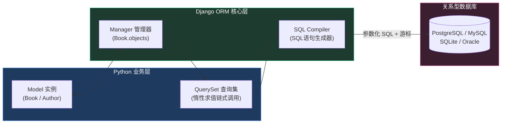
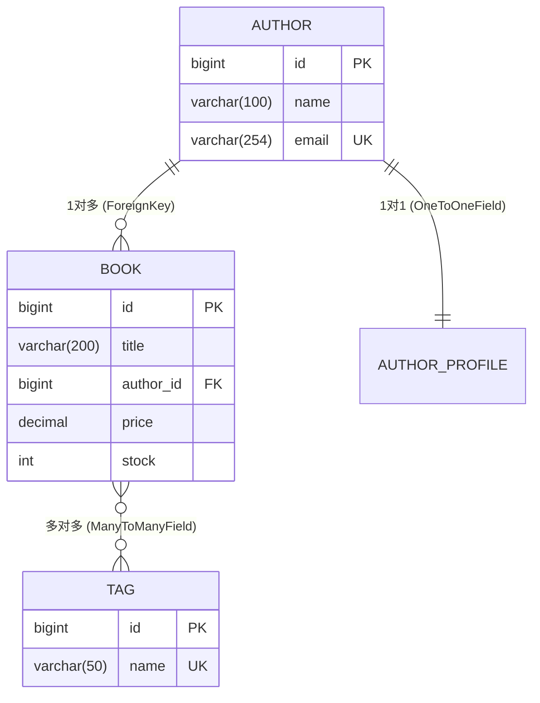

# Antigravity Artifact 完整特性演示指南

本示例文档位于项目工作区 [`examples/django_orm_demo.md`](file:///home/mazhao/workspace/AI_Learning/anti_markdown/examples/django_orm_demo.md#L1-L25) 中，演示如何让**任意项目目录下的 `.md` 文件**都拥有与 Antigravity IDE 内置脑图文档 [`django_orm_complete_guide.md`](file:///home/mazhao/.gemini/antigravity/brain/64de7d0d-2444-4f96-964a-05b73d2273f5/django_orm_complete_guide.md#L1-L55) 完全一致的预览和交互体验。

> [!IMPORTANT]
> **为什么原本只有 `.gemini/antigravity/brain/` 下的文档会启用内置编辑器？**
> Antigravity IDE 的内置插件 `google.google-antigravity` 在注册 `antigravity.artifactEditor` 时，限定了 `filenamePattern: "**/.gemini/*/brain/**/*.md"`。本插件既提供了**一键调用原生 `jetski-artifact:` 引擎**，也提供了**默认接管所有 `**/*.md` 的增强型自定义编辑器 (`antiMarkdown.artifactEditor`)**。

---

## 1. Mermaid 流程图与 ER 模型图渲染

### 1.1 Django ORM 架构分层图 (`flowchart LR`)



### 1.2 实体关系图 (`erDiagram`)



---

## 2. GitHub 风格高亮提示框 (Alerts)

> [!NOTE]
> **`[!NOTE]` 信息提示**：点击顶部工具栏的 **`✦ 原生内置视图 (jetski)`** 按钮（或按快捷键 `Ctrl+Alt+V`），可直接调用 Antigravity IDE 原生 `antigravity.artifactEditor` 打开当前项目文件。

> [!TIP]
> **`[!TIP]` 最佳实践**：在连表查询中，正向上的一对多/一对一关联使用 `select_related('author')`，多对多或反向一对多关联使用 `prefetch_related('tags')`。

> [!WARNING]
> **`[!WARNING]` 潜在风险**：切勿在 `for` 循环中直接访问未预加载的外键属性，否则会触发严重的 `N + 1` 查询风暴。

> [!CAUTION]
> **`[!CAUTION]` 生产安全警示**：使用 `QuerySet.update()` 进行批量更新时不会触发模型的 `save()` 方法和 `post_save` 信号。

---

## 3. Carousel 交互式代码轮播卡片

````carousel
### Slide 1: 糟糕写法（触发 N+1 查询）
```python
# 查询所有图书（1 次 SQL）
books = Book.objects.all()
for book in books:
    # 每次循环都会额外发起 1 次 SQL 查询！
    print(book.title, book.author.name)
```
<!-- slide -->
### Slide 2: 优化写法（使用 `select_related` + `prefetch_related`）
```python
from django.db.models import Prefetch

# 仅需 2 次 SQL 查询即可加载全部关联对象
books = (
    Book.objects
    .select_related('author')
    .prefetch_related('tags')
    .filter(is_published=True)
)
for book in books:
    print(book.title, book.author.name, [t.name for t in book.tags.all()])
```
<!-- slide -->
### Slide 3: 数据库层面原子自增（`F()` 表达式避免竞态条件）
```python
from django.db.models import F

# 直接生成 UPDATE shop_book SET stock = stock - 1 WHERE id = 1 AND stock >= 1
updated_rows = Book.objects.filter(id=1, stock__gte=1).update(
    stock=F('stock') - 1
)
```
````

---

## 4. 源码文件胶囊链接 (`file://` Pills) 与 LaTeX 数学公式

在 Antigravity Artifact 文档中，所有带 `file://` 协议或行号锚点 `#L10-L20` 的链接都会渲染为可点击跳转的胶囊标签：

- 插件主入口实现：[`out/extension.js`](file:///home/mazhao/workspace/AI_Learning/anti_markdown/out/extension.js#L120-L168)
- 原生桥接转换函数：[`openInNativeArtifactEditor`](file:///home/mazhao/workspace/AI_Learning/anti_markdown/out/extension.js#L125-L166)
- 渲染引擎实现：[`media/viewer.js`](file:///home/mazhao/workspace/AI_Learning/anti_markdown/media/viewer.js#L45-L120)

支持行内公式如查询耗时复杂度 $T(N) = \mathcal{O}(1) \ll \mathcal{O}(N + 1)$，以及独立块级公式：

$$
\text{Speedup} = \frac{T_{\text{N+1}}}{T_{\text{Eager}}} = \frac{t_{\text{base}} + N \cdot t_{\text{RTT}}}{t_{\text{join}}} \approx \frac{N \cdot \Delta t}{\epsilon}
$$

---

## 5. 特性对比表与交互式任务清单d's'f's

| 特性维度 | VS Code 默认侧边栏预览 | Antigravity 原生桥接模式 (`jetski`) | Antigravity Artifact Viewer Pro (本插件默认) |
| :--- | :---: | :---: | :---: |
| 适用范围 | 所有 `.md` | 任意项目 `.md`（自动注入 `jetski-artifact:`） | **所有项目 `**/*.md` 默认接管** |
| Mermaid 图表 | 需额外插件 | 原生支持 | **内置 SVG 渲染 + 缩放/DSL 查看** |
| `[!NOTE]` 等 5 种高亮框 | 基础或无 | 原生支持 | **完整 5 色高亮卡片** |
| `carousel` 轮播块 | 不支持 | 原生支持 | **完整多页轮播组件** |
| `file://#L10-L20` 胶囊跳转 | 不支持 | 原生支持 | **点击直接打开对应文件并高亮代码行** |
| 分栏实时源码编辑 | 需开两个标签页 | 仅只读预览 + 批注 | **内置 Preview / Split / Source 三模式** |

### 待办检查项 (可直接在预览中点击勾选并自动同步回源码)

- [x] 解析 Antigravity IDE 内置 `antigravity.artifactEditor` 的 `jetski-artifact:` 协议机制
- [x] 支持一键调用 Antigravity IDE 原生内置编辑器打开任意项目 `.md` 文件
- [ ] 实现支持 Mermaid、Alerts、Carousel、KaTeX 与 `file://` 胶囊跳转的 Custom Editor
- [ ] 点击上方标题右侧的 **`+ 批注 (Review)`** 按钮体验章节批注生成

